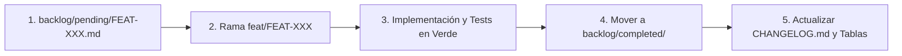

# Reglas de Flujo de Trabajo, Git y Gestión de Backlog

Este documento define el proceso de desarrollo colaborativo, versionamiento y ciclo de vida de los requerimientos en el proyecto.

---

## 🌳 Trunk-Based Development y Ramas

1. **Ramas de Ciclo de Vida Corto y Creación Previa:**
   - **Regla fundamental:** Antes de modificar o crear cualquier archivo de código o prueba para un feature del backlog, es obligatorio crear y situarse en una rama corta basada en `main`:
     ```bash
     git checkout main
     git pull origin main
     git checkout -b feat/FEAT-XXX-slug
     ```
   - Nunca implementar features o refactorizaciones directamente sobre `main`.
   - Todo trabajo debe reintegrarse a `main` en 1 a 2 días máximo.
   - Nomenclatura obligatoria de ramas:
     - Nuevas características: `feat/FEAT-XXX-slug`
     - Corrección de bugs: `fix/FIX-XXX-slug`
     - Deuda técnica / refactoring: `tech/TECH-XXX-slug`

2. **Conventional Commits:**
   Los mensajes de commit deben seguir la especificación formal para guiar el incremento de versión:
   - `feat(scope): mensaje` -> Incrementa versión **MINOR** (`0.1.0` -> `0.2.0`).
   - `fix(scope): mensaje` -> Incrementa versión **PATCH** (`0.1.0` -> `0.1.1`).
   - `feat(scope)!: mensaje` o `BREAKING CHANGE:` -> Incrementa versión **MAJOR** (`0.1.0` -> `1.0.0`).
   - `docs:`, `refactor:`, `test:`, `chore:` -> Mantenimiento interno sin incremento de versión pública.

---

## 📋 Ciclo de Vida del Backlog



### 1. Planificación de Nuevos Requerimientos:
- Toda nueva iniciativa debe redactarse utilizando la plantilla estándar [`backlog/TEMPLATE.md`](../../backlog/TEMPLATE.md).
- Guardar el archivo en `backlog/pending/` con el identificador secuencial correspondiente (`FEAT-002-slug.md`, `TECH-003-slug.md`).
- Registrar la nueva entrada en la tabla de [`backlog/pending/README.md`](../../backlog/pending/README.md) especificando la **versión objetivo** asignada.

### 2. Cierre de un Requerimiento (*Definition of Done*):
Cuando se completan todos los criterios de aceptación y los tests pasan al 100%:
- Mover físicamente el archivo desde `backlog/pending/` hacia `backlog/completed/`.
- Actualizar los metadatos internos del archivo (`Estado: Completado`, `Fecha de Finalización: AAAA-MM-DD`).
- Registrar el feature en la tabla de [`backlog/completed/README.md`](../../backlog/completed/README.md) bajo la versión entregada.
- Retirar la fila de [`backlog/pending/README.md`](../../backlog/pending/README.md).
- Documentar las notas de versión en [`CHANGELOG.md`](../../CHANGELOG.md).
