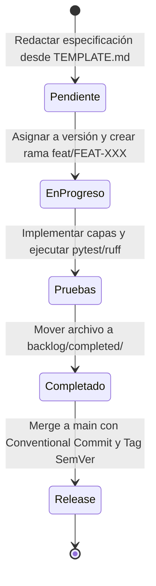

# 📋 Gestión del Backlog y Ciclo de Vida del Software

Este directorio administra el ciclo de vida de los requerimientos, el roadmap por versiones y el flujo de transición entre funcionalidades pendientes y completadas.

---

## 🗂️ Estructura del Backlog

```text
backlog/
├── README.md              # Este archivo (Guía de flujo y visión general)
├── VERSIONING.md          # Trunk-Based Development, Conventional Commits y SemVer
├── TEMPLATE.md            # Plantilla estándar ágil para nuevos requerimientos
│
├── pending/               # ⏳ REQUERIMIENTOS POR DESARROLLAR
│   ├── README.md          # 📌 Índice / Roadmap de features pendientes por versión
│   └── FEAT-001-...       # Especificaciones de features pendientes
│
└── completed/             # 🏁 REQUERIMIENTOS FINALIZADOS
    ├── README.md          # 📦 Historial de features completados por versión
    └── FEAT-000-...       # Especificaciones de features terminados
```

---

## 🧭 Enlaces Directos

- 📌 **[Roadmap y Features Pendientes](pending/README.md)**: Consulta qué se está construyendo y a qué versión está asignado.
- 🏁 **[Historial de Features Completados](completed/README.md)**: Revisa qué se entregó en cada versión.
- 🌳 **[Estrategia de Versionamiento (SemVer & Trunk-Based)](VERSIONING.md)**: Reglas de ramas, commits y tags.
- 📝 **[Plantilla para Nuevos Requerimientos](TEMPLATE.md)**: Plantilla ágil (User Story + Criterios + DoD).

---

## 🔄 Flujo de Vida de un Requerimiento



### Reglas de Transición:
1. **Creación:** Se copia `TEMPLATE.md` en `pending/` con prefijo `FEAT-XXX`, `TECH-XXX` o `FIX-XXX`. Se agrega a la tabla en [pending/README.md](pending/README.md).
2. **Inicio del Desarrollo (Paso Previo Obligatorio):** Antes de tocar cualquier archivo de código o tests, se crea una rama corta a partir de `main`:
   ```bash
   git checkout -b feat/FEAT-XXX-slug main
   ```
   *Está prohibido desarrollar directamente sobre la rama `main`.*
3. **Cierre:** Cuando se cumplen todos los criterios de aceptación y la suite de pruebas está al 100%, el archivo se mueve físicamente a `completed/`, se actualizan los índices en `pending/README.md` y `completed/README.md`, y se registra en `CHANGELOG.md`.
