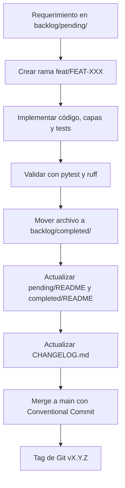

# Guía de Versionamiento y Flujo de Desarrollo

Este proyecto implementa **Trunk-Based Development** combinado con **Conventional Commits** y **Semantic Versioning (SemVer)** para automatizar y dar predictibilidad al ciclo de vida del software.

---

## 🌳 Trunk-Based Development

En lugar de mantener ramas de larga duración (como en GitFlow), todo el desarrollo converge rápidamente en la rama principal (`main` o *trunk*):

```text
      (v0.1.0)             (v0.1.1)            (v0.2.0)
main ────●────────────────────●───────────────────●──────>
          \                  / \                 /
           └── feat/FEAT-001┘   └── fix/FIX-002─┘
            (1-2 días máx)        (horas)
```

### Reglas de Ramas:
1. Las ramas de trabajo nacen de `main` y tienen un tiempo de vida corto (idealmente menos de 2 días).
2. Nomenclatura de ramas:
   - Funcionalidades: `feat/FEAT-XXX-slug`
   - Correcciones: `fix/FIX-XXX-slug`
   - Deuda técnica / Refactor: `tech/TECH-XXX-slug`
3. Cada merge a `main` debe tener la suite de pruebas al 100% en verde (`uv run pytest -v`).

---

## 🏷️ Semantic Versioning (SemVer 2.0.0)

El formato de versión es **`MAJOR.MINOR.PATCH`**:

$$\text{v}\underbrace{0}_{\text{MAJOR}}.\underbrace{1}_{\text{MINOR}}.\underbrace{0}_{\text{PATCH}}$$

| Segmento | Cuándo se incrementa | Tipo de cambio | Ejemplo |
| :--- | :--- | :--- | :--- |
| **PATCH** (`0.1.X`) | Correcciones de errores compatibles hacia atrás. | `fix:` | `0.1.0` -> `0.1.1` |
| **MINOR** (`0.X.0`) | Nuevas funcionalidades compatibles hacia atrás. | `feat:` | `0.1.1` -> `0.2.0` |
| **MAJOR** (`X.0.0`) | Cambios incompatibles / breaking changes en contratos de API o BD. | `feat!:` o `BREAKING CHANGE:` | `0.2.0` -> `1.0.0` |

---

## 📝 Conventional Commits

Los mensajes de commit deben seguir el estándar para que las herramientas determinen el incremento de versión y generen notas de release:

$$\text{\{tipo\}[ámbito opcional]: \{descripción concisa en imperativo\}}$$

### Tipos Permitidos:
- **`feat`**: Nueva funcionalidad (incrementa `MINOR`).
  - *Ejemplo:* `feat(users): agregar endpoint POST /users con validacion de email`
- **`fix`**: Corrección de un bug (incrementa `PATCH`).
  - *Ejemplo:* `fix(turso): corregir parametro de conexion url en lugar de database_url`
- **`refactor`**: Cambio en código que no añade features ni corrige bugs.
- **`test`**: Agregar o corregir pruebas unitarias o de integración.
- **`docs`**: Cambios exclusivos en documentación o especificaciones.
- **`chore`**: Mantenimiento de dependencias (`uv`), configuración o CI/CD.

### Breaking Changes:
Para indicar un cambio que rompe compatibilidad, añade un signo `!` antes de los dos puntos o un pie de página `BREAKING CHANGE:`:
- *Ejemplo:* `feat(items)!: cambiar formato de respuesta de lista a objeto paginado con cursor`

---

## 🔄 Flujo de Transición del Backlog a Release


