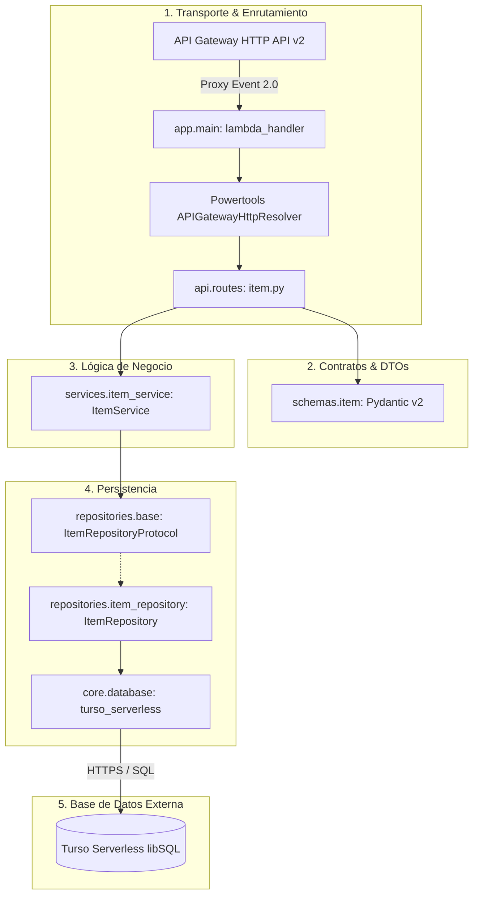
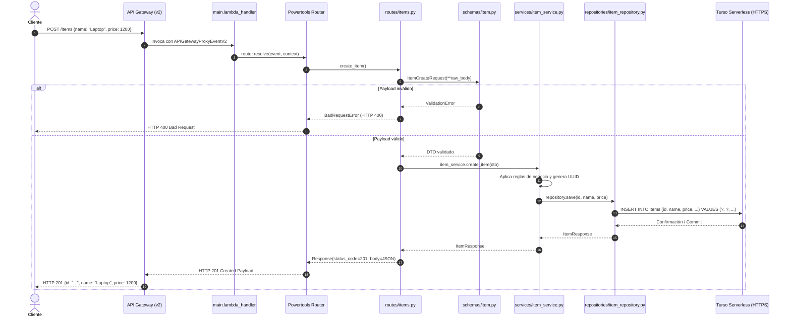

# Diseño y Arquitectura del Sistema

Este documento describe la arquitectura técnica de la aplicación, los principios de diseño aplicados y las reglas que garantizan la mantenibilidad y desacoplamiento del código.

---

## 🏛️ Filosofía Arquitectónica: Clean Architecture en Serverless

El objetivo principal de esta plantilla es **evitar el acoplamiento** típico de las funciones Lambda donde el código de infraestructura (API Gateway, eventos JSON, AWS SDKs) se mezcla con la lógica de negocio y las consultas SQL.

Aplicamos los principios de **Clean Architecture / Arquitectura Hexagonal** adaptados al ciclo de vida de AWS Lambda:

1. **Independencia del Transporte (HTTP):** La lógica de negocio no sabe qué es un `event`, un `statusCode` o una cabecera HTTP.
2. **Independencia de la Base de Datos:** Los servicios de negocio operan con entidades/DTOs y contratos abstractos (`Protocol`), no con SQL directo ni con el driver `turso-serverless`.
3. **Flujo Unidireccional de Dependencias:** Las capas externas dependen de las internas, nunca al revés.

---

## 📦 Detalle de las Capas

### 1. Capa de Transporte (`src/app/api/`)
- **Herramienta:** `aws-lambda-powertools` (`APIGatewayHttpResolver`).
- **Responsabilidad:**
  - Extraer el cuerpo de la petición (`router.current_event.json_body`), parámetros de ruta (`<item_id>`) y query params.
  - Instanciar y validar los DTOs de entrada de Pydantic.
  - Llamar a los métodos correspondientes de la capa de servicios.
  - Capturar excepciones de dominio y transformarlas en códigos HTTP adecuados (`400`, `404`, `500`).
- **Regla estricta:** Ningún controlador debe ejecutar lógica de negocio ni sentencias SQL.

### 2. Capa de Contratos y DTOs (`src/app/schemas/`)
- **Herramienta:** `pydantic` v2.
- **Responsabilidad:**
  - Definir la forma estricta de los datos entrantes (`ItemCreateRequest`, `ItemUpdateRequest`).
  - Definir la serialización de salida (`ItemResponse`, `ItemListResponse`).
  - Validaciones de tipo, longitud de cadenas, números positivos, etc.

### 3. Capa de Lógica de Negocio (`src/app/services/`)
- **Responsabilidad:**
  - Implementar los casos de uso (ej. crear item, validar unicidad, calcular totales, aplicar descuentos, cambiar estados).
  - Orquestar la persistencia a través de la interfaz del repositorio (`ItemRepositoryProtocol`).
  - Lanzar **excepciones de dominio** (`ItemNotFoundError`, etc.) cuando una regla no se cumple.
- **Regla estricta:** No debe importar nada de `aws_lambda_powertools`, ni `turso_serverless`, ni manejar diccionarios con estructuras HTTP.

### 4. Capa de Persistencia (`src/app/repositories/`)
- **Herramienta:** `turso-serverless` (DB-API 2.0).
- **Responsabilidad:**
  - Implementar la interfaz definida en `base.py`.
  - Construir y ejecutar sentencias SQL con parámetros seguros (`?`) para evitar inyecciones.
  - Mapear las tuplas retornadas por el cursor a los DTOs de dominio.
- **Regla estricta:** No debe contener reglas de validación de negocio.

### 5. Capa Core e Infraestructura (`src/app/core/`)
- **Responsabilidad:**
  - `config.py`: Resuelve credenciales dinámicamente desde AWS Secrets Manager (producción con caché) o variables locales (`.env`).
  - `database.py`: Mantiene la conexión singleton a Turso abierta para reutilizarla entre invocaciones en *warm starts*.
  - `exceptions.py`: Define la jerarquía de excepciones de negocio.
  - `logging.py`: Centraliza el `Logger` de Powertools, la sanitización de datos sensibles y el decorador transversal `@trace_call` para observabilidad y trazabilidad de inputs, outputs y duración sin alterar contratos.

---

## 🔄 Diagrama de Secuencia: Ciclo de Vida de una Petición

A continuación se muestra el flujo de ejecución completo al procesar un `POST /items`:

---

## 📋 Reglas de Oro para Desarrolladores

| Qué HACER ✅ | Qué NO HACER ❌ |
| :--- | :--- |
| Definir contratos con `typing.Protocol` en los repositorios. | Crear métodos de negocio directamente dentro de los archivos de rutas. |
| Inyectar dependencias en el constructor `__init__(self, repository=None)`. | Instanciar clientes externos o sockets dentro del cuerpo del handler (mata el rendimiento de warm starts). |
| Lanzar excepciones de dominio (`DomainException`) en el servicio. | Retornar tuplas HTTP `(..., 404)` desde el servicio. |
| Usar siempre parámetros `?` en sentencias SQL. | Concatenar cadenas con f-strings en SQL (`f"SELECT * FROM items WHERE name = '{name}'"`). |
| Tipar todas las funciones con Python 3.13 moderno (`X \| None`, `list[X]`). | Usar tipos heredados obsoletos como `Optional[X]` o `typing.List[X]`. |
