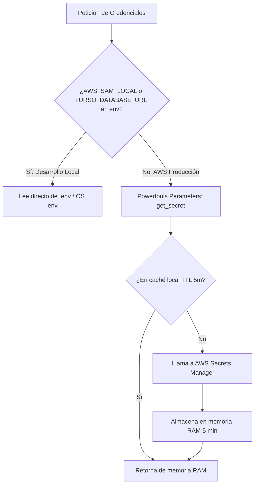

# Base de Datos: Turso Serverless (libSQL)

Este documento detalla el funcionamiento de la persistencia con **Turso Serverless** en AWS Lambda, cómo se gestiona la conexión sobre HTTP y las buenas prácticas de consultas y migraciones.

---

## ⚡ ¿Qué es Turso y por qué `turso-serverless`?

[Turso](https://turso.tech/) es una base de datos distribuida serverless basada en **libSQL** (un fork moderno y de código abierto de SQLite).

En entornos de funciones serverless como AWS Lambda, las conexiones TCP persistentes tradicionales (como las de PostgreSQL o MySQL) sufren con el escalado masivo de instancias efímeras. Turso resuelve esto permitiendo consultas **SQL sobre HTTPS**.

### Ventajas del driver `turso-serverless` en este proyecto:
1. **100% Pure Python:** No contiene extensiones compiladas en C ni binarios Rust. Esto elimina por completo los problemas de compatibilidad al desarrollar en Windows y desplegar en Lambda Linux `arm64` o `x86_64`.
2. **Estándar DB-API 2.0:** Cumple con la especificación estándar de Python (`connect`, `cursor`, `execute`, `fetchone`, `fetchall`, `commit`), haciendo la API familiar y sencilla.
3. **Cold-starts ultrarrápidos:** Al no inicializar pools de sockets complejos ni cargar librerías binarias pesadas, la función Lambda arranca en milisegundos.

---

## 🔐 Gestión de Credenciales y Secretos

Turso requiere dos datos para autenticarse:
- **`url`**: Formato `libsql://tu-base-de-datos.turso.io` (o `https://...`).
- **`auth_token`**: Token JWT generado desde la CLI de Turso (`turso db tokens create <nombre-db>`).

### Estrategia de resolución en dos niveles (`src/app/core/config.py`):



- **En desarrollo local:** Lee de `.env` a través de variables de entorno.
- **En AWS Lambda:** Invoca `parameters.get_secret("prod/turso/credentials", max_age=300)`. La caché en memoria por 5 minutos reduce drásticamente las llamadas a Secrets Manager (minimizando costos y latencia).

---

## 🌡️ Ciclo de Vida de la Conexión (*Warm Starts* vs *Cold Starts*)

En `src/app/core/database.py`, la conexión se gestiona como un **singleton a nivel de módulo**:

```python
_connection = None

def get_turso_connection():
    global _connection
    if _connection is None:
        db_url, auth_token = get_turso_credentials()
        _connection = turso_serverless.connect(
            url=db_url,
            auth_token=auth_token,
        )
    return _connection
```

### ¿Por qué esta práctica es crítica en Lambda?
- En un **Cold Start**, `_connection` es `None`. Se resuelven las credenciales y se inicializa el cliente.
- En los subsecuentes **Warm Starts** (cuando el contenedor de Lambda se reutiliza para atender peticiones sucesivas), `_connection` ya existe en la memoria del proceso, evitando volver a consultar Secrets Manager o reinstanciar el cliente HTTP.

---

## 🛡️ Buenas Prácticas de Consultas SQL

### 1. Consultas Parametrizadas (Obligatorio)
Usa siempre el marcador de posición `?` para pasar parámetros. **Nunca utilices concatenación de strings ni f-strings**:

```python
# CORRECTO ✅ (Previene inyección SQL)
cursor.execute("SELECT * FROM items WHERE id = ?;", (item_id,))

# INCORRECTO ❌ (Vulnerable a SQL Injection)
cursor.execute(f"SELECT * FROM items WHERE id = '{item_id}';")
```

### 2. Confirmación de Transacciones (`commit`)
Para operaciones de escritura (`INSERT`, `UPDATE`, `DELETE`), debes llamar explícitamente a `conn.commit()`:

```python
with conn.cursor() as cursor:
    cursor.execute("UPDATE items SET price = ? WHERE id = ?;", (new_price, item_id))
    conn.commit()
```

### 3. Migraciones y Creación de Tablas (DDL)
Cada repositorio implementa un método `init_table()` que utiliza `CREATE TABLE IF NOT EXISTS`:

```sql
CREATE TABLE IF NOT EXISTS items (
    id TEXT PRIMARY KEY,
    name TEXT NOT NULL,
    price REAL NOT NULL,
    description TEXT,
    created_at TEXT NOT NULL
);
```

Para migraciones manuales o administración directa, puedes conectar la CLI oficial de Turso:
```bash
turso db shell <nombre-de-tu-base-de-datos>
```
O invocar el endpoint de inicialización administrativa:
```bash
curl -X POST https://<api-id>.execute-api.us-east-1.amazonaws.com/admin/init-db
```
